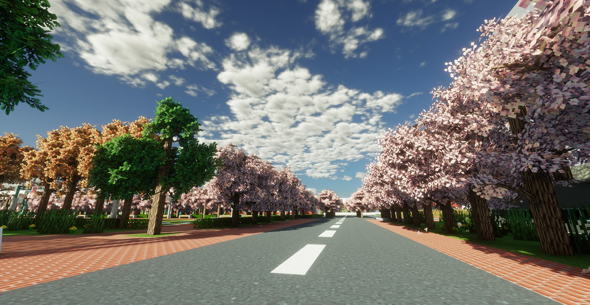
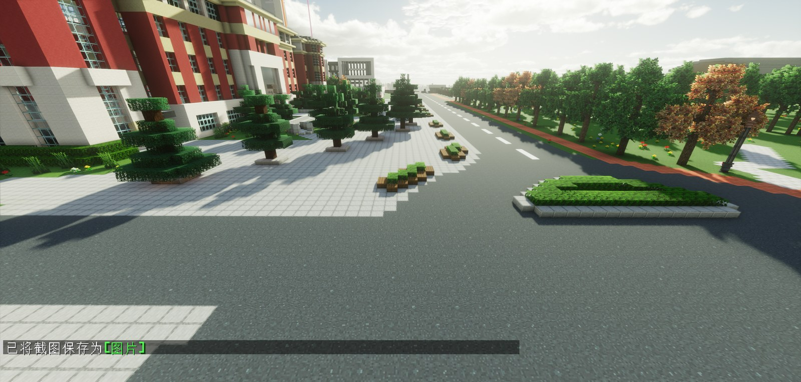

<div align="center">


# 燕理复原工程

**Yanli Campus Restoration — 在 Minecraft 里重建燕京理工学院**

[](#运行环境)
[](#运行环境)
[](#许可证)
[](#许可证)
[](#与校方的关系)

**燕理MC玩家创作协会（YITMC）集体资产** · **燕京理工学院校方合作项目**

[项目简介](#项目简介) · [快速开始](#快速开始) · [模组清单](#模组清单) · [参与贡献](#参与贡献) · [许可证](#许可证)

</div>

---

## 项目简介

**燕理复原工程**是燕理MC玩家创作协会（YITMC）发起的校园复原计划：在 Minecraft 1.20.1 中，按照燕京理工学院真实校园的布局、建筑与景观，逐步复原教学楼、道路、绿化与公共空间，建成一座可以自由行走、可以继续扩建的「数字校园」。

这个项目希望做到三件事：

- **留住校园**——把大家每天走过的路、上过课的楼，用方块记录下来；
- **一起建造**——给社团成员一套统一的整合包、配置和协作规范，让不同人建的成果能拼在一起；
- **对外开放**——存档与建筑成果以非商业方式公开，供在校生、校友和建筑爱好者参观、学习与二次创作。

> 本项目由燕理MC玩家创作协会发起，与燕京理工学院校方保持合作关系，属于**半官方校园文化项目**。项目内容由社团独立创作与维护，不代表校方对具体内容的正式立场。

### 预览




---

## 社团资产声明

> **本仓库及其中的全部原创内容，均为燕理MC玩家创作协会（YITMC）的集体资产。**

具体包括：世界存档与建筑作品、投影与结构文件、配置方案、文档、截图、宣传素材，以及本项目衍生的整合包。

- 上述内容由社团成员协作创作，**著作权由社团集体享有**，不归属任何个人；
- 仓库应存放于社团组织账号下，个人成员不得以个人名义转让、注册、质押或主张独占权利；
- 任何对外使用——转载、二次发布、商用、文创开发、商业展出——须事先取得社团书面许可；
- 参与贡献即视为同意《贡献者授权声明》，详见 [CONTRIBUTING.md](CONTRIBUTING.md)。

完整的资产归属说明见 [NOTICE](NOTICE)。

### 与校方的关系

本项目为**半官方合作项目**：由燕理MC玩家创作协会发起，负责创作、技术实现与日常维护；与燕京理工学院校方按双方合作协议开展合作，校方可在教学、招生宣传、校园文化建设等场景中使用项目成果。

- 燕理MC玩家创作协会是燕京理工学院**注册学生社团**，社团身份可由校方核实；
- 项目对外发布的内容由社团负责，**不代表校方的正式立场或官方发布**；
- 校名、校徽等标识依据双方合作协议使用，权利归学校所有；
- 校方在本项目中的具体使用范围与权利，以双方合作协议为准。

---

## 快速开始

### 方式一：导入整合包（推荐）

1. 打开 [Releases](https://github.com/YITMC/YIT-restoration/releases) 页面，下载最新的 `燕理复原-*.mrpack`；
2. 用启动器导入：
   - **HMCL**：版本列表 → 安装新游戏 → 从整合包导入；
   - **PCL2**：下载 → 整合包 → 导入本地整合包；
   - **Modrinth App**：Add instance → From file；
3. 首次启动会自动补齐模组与配置（需联网）；
4. 将发布页提供的世界存档解压到 `.minecraft/saves/` 下即可进入校园。

### 方式二：手动配置

1. 安装 **Minecraft 1.20.1** + **Fabric Loader 0.16.14**（Java 17）；
2. 按下方[模组清单](#模组清单)安装 25 个模组（版本需一致）；
3. 将仓库中的 `config/` 覆盖到版本目录，`resourcepacks/`、`shaderpacks/` 放入对应目录；
4. 将世界存档解压到 `saves/`，启动游戏。

> 模组请从 CurseForge / Modrinth 官方页面下载，本项目**不转载**任何第三方 jar。

---

## 运行环境

| 项目 | 要求 |
| --- | --- |
| 游戏版本 | Minecraft **1.20.1** |
| 模组加载器 | Fabric Loader **0.16.14** |
| Java | **Java 17**（64 位） |
| 内存 | 建议分配 **6–8 GB** |
| 显卡 | 支持 OpenGL 3.2+；开启光影建议独立显卡 |
| 系统 | Windows 10/11、Linux、macOS 均可 |

整合包同时安装了 Sodium 与 Embeddium 两套渲染优化方案，并提供 **Iris** 光影支持与 **Distant Horizons** 远距离渲染。低配机器可在视频设置中关闭光影、下调远距离地平线的 LOD 距离。

---

## 模组清单

共 **25** 个模组，全部来自 Modrinth（整合包按 SHA-512 校验文件）。仅列出名称、版本与用途，版权归各模组作者所有。

<details>
<summary><b>展开完整清单</b></summary>

### 基础前置

| 模组 | 版本 | 用途 |
| --- | --- | --- |
| Fabric API | 0.92.12+1.20.1 | Fabric 模组基础 API |
| Architectury API | 9.2.14 | 跨平台模组前置 |
| Cloth Config API | 11.1.136 | 配置界面库 |
| Balm | 7.3.41 | KleeSlabs 前置库 |
| MaLiLib | 0.16.3 | Litematica 前置库 |

### 性能与画面

| 模组 | 版本 | 用途 |
| --- | --- | --- |
| Sodium | 0.5.13 | 渲染优化 |
| Sodium Extra | 0.5.9 | Sodium 扩展设置 |
| Indium | 1.0.36 | Fabric Rendering API 兼容层 |
| Iris Shaders | 1.7.6 | 光影加载 |
| Embeddium | 0.3.31 | 渲染优化（Forge 系移植） |
| Distant Horizons | 3.3.2 | 远距离地形渲染（LOD） |

### 建筑工具

| 模组 | 版本 | 用途 |
| --- | --- | --- |
| Axiom | 4.7.1 | 实时建筑编辑与雕刻 |
| WorldEdit（创世神） | 7.2.15 | 批量建造与地形编辑 |
| WorldEditCUI | 1.20+01 | WorldEdit 选区可视化 |
| Litematica（投影） | 0.15.4 | 投影放置与建造辅助 |

### 装饰与建造细节

| 模组 | 版本 | 用途 |
| --- | --- | --- |
| Yuushya（方块小镇） | 2.2.3 | 现代建筑装饰方块 |
| KleeSlabs | 15.0.6（Fabric） | 只破坏半砖的一半 |
| Enchanted Vertical Slabs | 2.2.1 | 竖直半砖 |

### 辅助

| 模组 | 版本 | 用途 |
| --- | --- | --- |
| Mod Menu | 7.2.2 | 模组列表与配置入口 |
| ReplayMod | 2.6.20 | 游戏录像与回放 |
| CustomSkinLoader | 14.23 | 第三方皮肤加载 |
| 3D Skin Layers | 1.7.5 | 3D 皮肤外层 |
| I18nUpdateMod | 3.7.0 | 模组自动汉化更新 |
| ChatImage | 1.4.7 | 聊天栏图片显示 |
| CmdKeyBind | 1.6.3 | 命令宏按键 |

</details>

**资源包**：Minecraft-Mod-Language-Modpack（模组汉化，2.0 MB）
**光影**：Derivative Main d24.4.4（国创写实风格，兼容 Distant Horizons，19.9 MB）

> 资源包与光影因第三方授权原因**不随整合包分发**，请从各自发布页下载后放入 `resourcepacks/` / `shaderpacks/`。另：色轮（LotTweaks）为 Forge 版，在 Fabric 下不生效，未纳入整合包。

---

## 仓库结构

```text
YIT-restoration/
├── README.md              # 本文件
├── NOTICE                 # 社团资产与版权归属声明
├── LICENSE                # PolyForm Noncommercial 1.0.0（代码/配置/脚本）
├── LICENSE-ASSETS.md      # CC BY-NC-SA 4.0（建筑存档/截图/文档）
├── CONTRIBUTING.md        # 贡献指南与贡献者授权声明
├── .gitignore
├── config/                # 项目统一模组配置
├── schematics/            # 校园投影与结构文件（incoming/ 为收件区）
├── docs/
│   ├── images/            # README 与宣传用图
│   ├── 复原范围.md         # 已复原/规划中的区域清单
│   └── 协作规范.md         # 建造标准、分区、命名与提交规则
└── scripts/               # 环境检查、模组校验等辅助脚本
```

### 仓库不包含什么

为避免仓库膨胀和隐私泄露，以下内容**不进入 Git**：

- `saves/` 世界存档（体积大，改由 Releases 分发）
- `Distant_Horizons_server_data/`、存档内的 `DistantHorizons.sqlite`（LOD 缓存，可重新生成）
- `logs/`、`crash-reports/`、`replay_recordings/`
- 第三方模组 jar、光影与资源包原文件
- `servers.dat`、`usercache.json`、`playerdata/` 等含服务器地址或玩家 UUID 的文件
- 启动器缓存、皮肤缓存、本机路径信息

---

## 世界存档与发布

| 项目 | 说明 |
| --- | --- |
| 主存档 | `燕京理工学院复原工程-2026-11-06` |
| 完整体积 | 约 **3.3 GB**，其中 **2.5 GB** 为 `data/DistantHorizons.sqlite` |
| 发布体积 | 剔除 LOD 缓存后约 **800 MB**（压缩后更小） |
| 分发方式 | GitHub Releases（单个文件 < 2 GB）；超出时使用分卷或网盘镜像 |

存档中的 LOD 缓存删除后，客户端首次进入会重新生成，不影响建筑本身。发布前还会清除玩家数据、统计与聊天记录。

---

## 参与贡献

欢迎社团成员和校外同好参与建造、修 bug、补文档。

### 建筑类贡献

- 以 `.litematic` 或 `.schem` 提交到 `schematics/incoming/`；
- 命名格式：`YYYYMMDD_区域_作者.litematic`，例如 `20261106_图书馆_张三.litematic`；
- 在 PR 描述中附上游戏内截图、坐标范围与所用模组版本；
- 大型改造请先开 Issue 讨论，避免与其他人冲突。

### 代码 / 文档类贡献

- Fork → 新建分支 → 提交 PR；
- 提交前请确认没有把 `saves/`、`mods/`、日志或个人配置带进来。

### 禁止提交

- 第三方模组 jar、光影、付费材质；
- 服务器地址、玩家 UUID、聊天记录等个人信息；
- 未经授权的他人作品。

详细规范见 [CONTRIBUTING.md](CONTRIBUTING.md)。

---

## 许可证

本项目按**内容类型**分别授权：

| 内容 | 许可证 | 你可以做什么 |
| --- | --- | --- |
| 代码、脚本、配置文件 | [PolyForm Noncommercial 1.0.0](LICENSE) | 非商业使用、修改、再分发，需保留版权声明 |
| 建筑存档、投影、截图、文档 | [CC BY-NC-SA 4.0](LICENSE-ASSETS.md) | 署名 + 非商业 + 相同方式共享 |
| 第三方模组、光影、汉化包 | 各自原始许可证 | 请遵循原作者条款，本项目不重新分发 |

### 为什么不是 BSD？

BSD 2-Clause / 3-Clause 是**宽松许可证**，明确允许商业使用；一旦加上「禁止商用」，它就不再是 BSD，也不符合 OSI 对开源许可证的定义（OSI 不允许限制使用领域）。因此本项目改用专门为「源码公开 + 禁止商用」设计的 **PolyForm Noncommercial 1.0.0**，建筑与美术资产使用 **CC BY-NC-SA 4.0**。

如果你确实需要 BSD 那样的极简条款、并且接受商业使用，可以把 `LICENSE` 换成 BSD-3-Clause，但请明确：**那时任何人都可以商业使用本项目**。

### 校方使用

本项目为半官方合作项目。燕京理工学院校方在教学、招生宣传、校园文化建设等非商业场景中的使用，依双方合作协议执行；协议未作约定的，视为社团已授予校方永久、免费、非独占的使用许可。

### 商业授权

校园文创、商业服务器、收费展出、影视/广告取景等商业用途，需单独取得书面许可。
请通过本仓库 Issues 或社团公开渠道联系负责人。

> 说明：社团可为成员在 B 站 / YouTube 等平台发布的**带创作激励的游玩、建造视频**另行出具内容创作许可，不以商业授权论处。

---

## 致谢

- 燕理MC玩家创作协会全体参与建造与测试的成员；
- [Fabric](https://fabricmc.net/) 与所有模组作者；
- [PolyForm Project](https://polyformproject.org/) 与 [Creative Commons](https://creativecommons.org/)；
- Mojang Studios 与 Minecraft。

## 免责声明

- 本项目为**半官方合作项目**，由燕理MC玩家创作协会创作与维护；项目内容不代表燕京理工学院校方的正式立场或官方发布；
- 仓库不包含 Minecraft 游戏本体，游玩需自行购买正版并遵守 [Minecraft EULA](https://www.minecraft.net/eula)；
- 校名、校徽等标识依据双方合作协议使用，相关权利归学校所有；
- 第三方模组的版权与责任归其作者，使用前请阅读各自许可证。

---

<div align="center">

**燕理MC玩家创作协会（YITMC）** · 用方块留住校园

</div>
